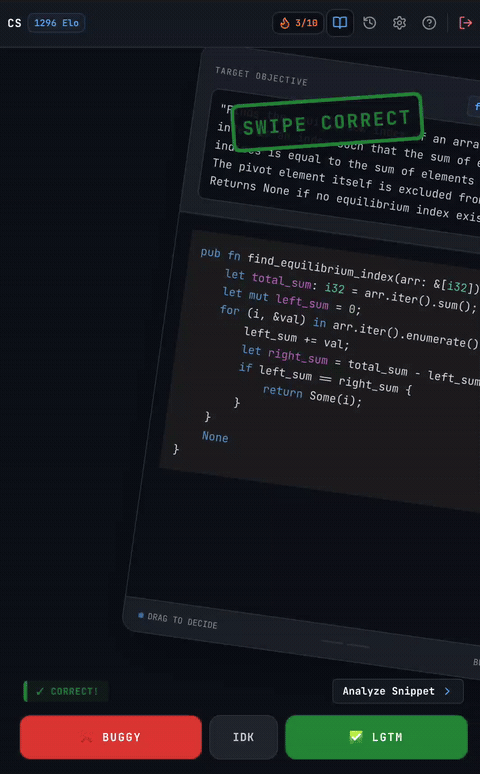

# Code Swipe - Code tutoring

Code Swipe is a tool to practice your coding skills by swiping right or left to answer if the presented problem and solution are buggy or not.

Code Swipe currently supports self-hosted use only.

The swipe model means students can practice a few minutes a day while progressing through lessons. Unlike platforms which require typing out the solution, code-swipe makes learning in short chunks of time tractable.



Code Swipe is built around a single teaching agent, powered by your installed **Codex** or **OpenCode** CLI. 

It proposes learning directions, sketches a curriculum spanning several short lessons, and adjusts the remaining plan as you learn.

As you demonstrate more knowledge, it attempts to present a mix of old and new problems to teach you new things and train your existing knowledge.

## Try it

Requires Node.js 22+ and npm. From this directory:

```sh
npm ci
npm run dev
```

Open **http://127.0.0.1:3000**. Choose **Practice demo** in Setup for a local walkthrough, or use your signed-in CLI:

```sh
codex login
# or
opencode auth login
```

JavaScript runs in the app’s built-in sandbox. For Python or Rust, install and start Docker, then download the appropriate pinned sandbox image once:

```sh
docker pull python:3.12-slim@sha256:aa943ce411423c7582288f18707ff66eddcbaeb510502d747a72aeb34f30d159
docker pull rust:1.89-slim-bookworm@sha256:d7fc7de78bb8c1469933aeecbf801314d30d7d6e9f0578bba4cfa285bfa37fe6
```

Restart the server after preparing an image. Setup shows whether each sandbox is available; the app never falls back to running generated Python or Rust directly on your machine.

### What v1 Does

Code swipe makes it easy to complete a few coding lessons and practice code review in short chunks of time.

- **Personalized learning:** Suggests three learning paths, recommends one, and builds a flexible 2–6 lesson curriculum that adapts to your progress.
- **General practice:** Generates a separate mix of familiar skills, useful combinations, and nearby new ideas. You can switch between an unfinished curriculum lesson and unfinished practice without losing either place.
- **Smart diagnostics:** Tracks mistakes without overreacting. Extra practice is triggered by repeated struggles, not isolated errors.
- **Intentional questions:** Plans 6–12 questions per lesson, each designed to teach, test, reinforce, or explore specific skills.
- **Clear cards:** Shows the task, the source to inspect, and the exact question separately; code review usually asks whether the implementation matches the task.
- **Long-term understanding:** Tracks concept familiarity, uncertainty, prerequisites, and progress across lessons while avoiding unnecessary repetition.
- **Skill-aware grading:** Distinguishes independent mastery from assisted success and recognizes skills practiced within harder problems.
- **Verified challenges:** Tests coding questions and solutions in isolated sandboxes for JavaScript, Python, and Rust, repairing or rejecting invalid batches.
- **Reliable progress tracking:** Saves lesson plans, answers, review activity, and feedback without duplicating history.
- **Tutor conversations:** Lets you discuss lessons with your chosen CLI tutor, with feedback informing future lessons.
- **Performance measurement:** Tracks prediction accuracy and calibration across tutors and learning contexts, without confusing them with mastery.
- **Fair baseline:** Compares personalized tutoring against a fresh-context tutor using the same question-generation and validation process.

## Knowledge & Contexts

We attempt to have the agent prepare topics with multiple lessons, then once that topic is complete, present new topics you may be interested in learning as the next direction.

- **Personal knowledge graph:** Builds a growing map of what you know, how concepts connect, and where you can apply them.
- **Context-aware progress:** Tracks understanding across different languages and tools, without assuming a skill learned in one transfers automatically to another.
- **Connected learning:** Organizes topics, concepts, techniques, and skills to reveal relationships and guide future lessons.
- **Learning notebook:** Browse your knowledge by topic, filter by context, review evidence, and access personalized study guides.
- **Continuous improvement:** Refines and connects knowledge records as you learn, while preserving your history and progress.
- **Safe upgrades:** Existing notebooks update automatically without losing lessons, answers, or learning history.

## Local Data & AI Integration

Data is stored locally.

- **Private local storage:** Lessons, answers, and progress are stored on your device, outside Git.
- **Your existing AI tools:** Works with Codex or OpenCode using your existing authentication, model preferences, and provider limits.
- **Personalized context:** The tutor uses your learning history, notes, feedback, and past performance to tailor future lessons.
- **Persistent tutor memory:** Maintains continuity across sessions while keeping outdated or discarded work out of your learning history.
- **Baseline mode:** Offers fresh, history-free tutoring for comparison.
- **Export & backup:** Export your learning records or back up your data to preserve progress.
- **Historical improvements:** Older lessons can receive updated skill assessments or clearer explanations without changing original answers or grades.
- **Flexible configuration:** Customize settings, retry stalled requests, and resume learning after interruptions.

```sh
npm run lint
npm test
npm run build
npm start
```

See [the architecture notes](docs/local-tutor.md) for the experiment's boundaries and [the original project notes](docs/original-project.md) for its earlier design.

Originally created with Google App Studio
