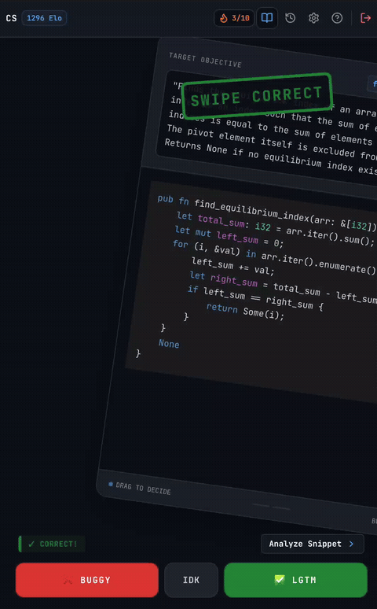

# Code Swipe — local tutor lab

Read a little code or a proposed technical answer. Swipe right for correct, left for buggy/incorrect, or choose IDK. Keep playing, and open an explanation whenever you want one.

This branch rebuilds Code Swipe around a single teaching agent, powered by your installed **Codex** or **OpenCode** CLI. It keeps a notebook of tentative learner hypotheses, plans short lessons, and commits its predictions *before* you answer. Your answers shape the next lesson. No account system, Firebase, subjects, Elo, or mastery tree.

## Try it

Requires Node.js 22+ and npm. From this directory:

```sh
npm ci
npm run dev
```

Open **http://127.0.0.1:3000**. Click **Try practice demo** for a local walkthrough, or use your signed-in CLI:

```sh
codex login
# or
opencode auth login
```

JavaScript runs in the app’s built-in sandbox. For Python or Rust, install and start Docker, then download the appropriate pinned sandbox image once:

```sh
docker pull python:3.12-slim@sha256:aa943ce411423c7582288f18707ff66eddcbaeb510502d747a72aeb34f30d159
docker pull rust:1.89-slim-bookworm@sha256:d7fc7de78bb8c1469933aeecbf801314d30d7d6e9f0578bba4cfa285bfa37fe6
```

Restart the server after preparing an image. Setup shows whether each sandbox is available; the app never falls back to running generated Python or Rust directly on your machine.

Choose your provider, preferred contexts, and interests in **Setup**, then start a lesson. The tutor can explore related technologies and domains automatically, or mix two contexts for a deliberate transfer lesson. Excluded contexts and their specializations are avoided. Changes apply to the next lesson; focused practice keeps the guide’s context. Leave the model blank for the CLI default, or enter a Codex model name / OpenCode `provider/model` identifier. Restart the server after installing a missing CLI. Codex requires **0.153.4 or newer** for this app's isolation options; OpenCode was tested with 1.17.13. Setup shows the version found by the server. If it differs from your terminal's version, set `CODE_SWIPE_CODEX_BIN` in `.env` to the supported executable's absolute path.

Drag the card, use the buttons, or press the arrow keys. Answers advance straight to the next card. **Review previous** opens the explanation without interrupting the next question; older answers remain in **Notebook**. IDK records uncertainty without counting as a wrong answer.

At the end of a lesson, share any feedback: your reasoning, confusion, corrections, pacing, interests, or what you want next. **Send to tutor** gets a short reflection and up to three optional follow-up questions. Reply to any you want, leave others blank, or go straight to **Next lesson**. You can also continue while the tutor is thinking. Notes and replies help the reflective tutor reconsider its assumptions; skips carry no penalty. **Update tutor** lets you discuss further before continuing, and **Notebook** keeps the exchange.

You can mark accidental answers before requesting the next batch. Those answers stay in your record but are excluded from evidence and metrics. Flawed exercises can also be flagged in their review. Feedback can change the tutor's interpretation without changing old grades or predictions.

The demo uses curated examples and neutral predictions. It is not adaptive. For the actual experiment, switch to Codex or OpenCode.

## What this v1 does

- Plans 6, 8, or 12 questions at a time (8 by default), with explicit assumptions, alternative explanations, and predictions.
- Gives each question educational and investigative objectives, with multiple purposes such as practice, transfer, retention, frontier exploration, or checking a teaching strategy. Lessons record their mix, progression, cognitive demand, and scaffolding; planning checks reject missing or inconsistent annotations.
- Builds durable concept evidence from the lesson archive, including familiarity, uncertainty, prerequisites, representations, and deferred variants. Each lesson includes at most one closely related pair for a new concept; other counterparts stay deferred or unasked with a reason.
- Distinguishes skills directly targeted, exercised inside a harder task, and merely present. Meaningful embedded practice can keep older skills in use without repeating their original questions. Each card commits what success or failure could indicate for each skill. Supported scaffolded successes contribute evidence while retaining the context of the help provided; they do not establish independent competence.
- Runs each reference solution and candidate against generated fixtures in an isolated, resource-limited sandbox: QuickJS for JavaScript and disposable Docker containers for Python and Rust. Both Rust implementations must compile; buggy cards require a behavioral counterexample or runtime failure. Unsupported topics use the same swipe cards and grading, with their lack of independent verification recorded in review. Failed batches get up to three repair attempts before being rejected.
- Saves immutable plan artifacts before showing a question. Answers append to local history; retries do not duplicate them.
- Records review openings and estimated active viewing time, so the tutor can account for explanations you chose to inspect. Background or unfocused time is paused.
- Supports optional conversations after a lesson. Each **Send to tutor** or **Update tutor** requests one bounded response from your selected CLI; the next lesson considers saved feedback and replies.
- Tracks Brier score and calibration for each provider and tutor mode across learning contexts. These measure prediction quality, not learning or mastery.
- Offers a fresh-context baseline that gets the same generation and validation pipeline without learner history or persistent hypotheses.

After a lesson, question reviews include optional intent details. Completed lessons reveal curriculum notes in **Notebook**, separating observed answers from the tutor's interpretation and proposed next action. Later observations build on archived evidence without rewriting earlier intent. These planning rules are experimental, not validated pedagogy or a mastery assessment.

Existing lessons remain readable without curriculum annotations. Newly generated lessons include them; a current batch stays fixed, and answers or feedback influence the next lesson.

Skill memory keeps the last targeted encounter, last meaningful exercise, and last independent supporting answer separately. Raw right/wrong counts still describe whole-card judgments, not successes or failures on every component. The tutor uses the evidence and its uncertainty to choose embedded practice or focused checks; there is no automatic forgetting timer. Skill roles and interpretations are model judgments, not proof of the learner's reasoning. An old prerequisite is not credited merely because it appears in a dependency chain.

Executed code exercises are **pure, synchronous JavaScript, Python, or Rust functions** using JSON-compatible test data. Other contexts, such as NumPy, pandas, React, Linux, and networking, can use code or proposed-answer cards without execution. Reviews explicitly say **Not independently verified** for these cards. Their answers contribute to evidence and metrics like other answers until flagged invalid. An executable question that fails its checks must be repaired; it cannot silently become unverified. Descriptive function names and natural parameter lists are used in each language. JavaScript uses multiline JSDoc, Python uses multiline docstrings, and Rust uses `///` documentation and explicit types. Python supports selected standard-library modules. Rust supports common scalar types, strings, vectors, slices, `Option`, `Result`, and string-keyed hash maps, including borrowed inputs; custom structs, mutable references, and third-party dependencies are outside this first version. Tests are finite checks, not proofs: a generated specification, reference solution, or fixture can still be wrong. The flag button exists for that reason.

Before a lesson that may introduce new concepts, an optional preview links to short concept guides. You can skip straight to the cards, read a guide, or request four or six focused practice cards before returning to the main lesson. You can also open related guides from an answer review. Focused practice can be left early; any answers already given are saved. Guides use reviewed examples for a few common concepts and generate others on demand with your selected tutor. Guides and reference links are specific to their learning context. Examples, including multiline snippets, are checked where an execution environment supports the context; other examples retain their lack of verification. Checking examples cannot guarantee the guide's explanation is correct.

Guide opens, completed readings, optional familiarity reports, and focused-practice answers are stored separately from committed lesson plans. Reading a guide or reporting familiarity is not treated as proof of understanding. If you study after a lesson's predictions were committed, review shows that teaching occurred before your answer; the original predictions are preserved.

## Knowledge and contexts

The tutor grows a learner-specific knowledge graph. Concepts describe what you learn; contexts describe where you use it; relationships suggest prerequisites, specializations, connections, and applications. Execution environments describe what the app can actually check. The graph can include topics before a runner exists for them. No dependencies are installed by the agent.

Evidence and familiarity are tracked per concept and context. Success with Python aggregation can motivate a pandas transfer question without establishing familiarity with `groupby()`. A context's parent and a concept's prerequisites never automatically receive credit. Prerequisites guide preparation rather than enforcing a fixed progression. Lessons can lower demand for a bridge into a new context before building again.

**Notebook → Knowledge & contexts** lets you search concepts, inspect contextual evidence and relationships, and review identity history. The tutor reuses stable identities and may merge clear equivalents automatically. **Undo merge** rebuilds the derived evidence while preserving archived questions and predictions. General concepts and their specializations remain distinct.

Existing notebooks migrate to version 2 on startup, after checking their sealed plans. Migration saves a complete state/plan backup under `.code-swipe/backups/knowledge-v1-*`; it does not change original lesson files, hashes, answers, or active progress. To inspect a migration first, run `npm run migrate:knowledge -- --data-dir .code-swipe`. With the server stopped, add `--apply` to perform it. Repeating migration does nothing.

## Local data and model calls

History lives in `.code-swipe/`, which Git ignores. The server listens on loopback only. Your browser needs no API key. Codex/OpenCode still sends lesson context to whichever model provider your CLI uses; those requests use your existing account and its normal limits or charges. “Local” describes the app and its storage, not necessarily inference.

The tutor receives recent answered lessons, your lesson notes, optional conversations, review timings, evidence supporting current hypotheses, and concept evidence reconstructed from the archive so older concepts survive the recent-history window. Baseline mode receives none of that history. CLI tools, workspace instructions, and plugins are disabled for these planning calls; this app supplies the complete context. OpenCode's global configuration is isolated, so choose a model explicitly if its default is unsuitable. Existing CLI authentication remains in use.

**Export record** downloads plans and raw answers, including answers for any unfinished lesson. Keep it private if you want to preserve the exercise. Back up the entire data directory to restore it; export is for inspection, not an import format. Run only one server against a given data directory.

Older questions can receive a separate retrospective skill review, stored in `skillRetrofits` and included in exports. Reviews preserve the original lesson files, predictions, grades, feedback, and timestamps. They can guide future teaching, but cannot alone establish the `familiar` label. Flagging an answer also excludes its retrospective evidence.

To import a reviewed annotation file, stop the server first, then run `npm run retrofit:skills -- --data-dir .code-swipe --review PATH` for a dry run. Add `--apply` to back up the state and plans, validate the archive fingerprint, and append the review. Restart the server afterward. Running without `--review` prints the fingerprint and concept IDs for preparing a review. The format is `SkillRetrofit` in `src/types.ts`: review actual specifications, implementations, answers, and feedback; assign roles conservatively and document ambiguity. The command does not invent historical teaching intentions or automatically infer skills from code syntax. Reimporting an identical review does nothing; stale or conflicting reviews are rejected.

Optional settings are listed in [.env.example](.env.example). Copy it to `.env` to change the port, data directory, executable paths, or per-call planning timeout. Cancel/retry is available if a provider stalls. Starting the server again keeps completed work and allows a fresh attempt after an interrupted run.

Older answered questions can also receive a separate presentation revision: clearer wording, descriptive names, and multiline JSDoc. Reviews show the revised version and let you open the original wording and code. Original plans, answers, grades, predictions, and tutor evidence stay unchanged. With the server stopped, use `npm run retrofit:presentation -- --data-dir .code-swipe --review PATH` to check a manually reviewed `PresentationRevision` (defined in `src/types.ts`); add `--apply` to back up and import it. Every original fixture is run against both versions before importing. This checks the saved examples, so the reviewer must also verify that the wording, constraints, and implementation behavior remain equivalent. Revisions are included in exports, and stale or conflicting imports are rejected.

```sh
npm run lint
npm test
npm run build
npm start
```

See [the architecture notes](docs/local-tutor.md) for the experiment's boundaries and [the original project notes](docs/original-project.md) for its earlier design. The original gameplay recording shows that earlier version:



Created with Google App Studio
